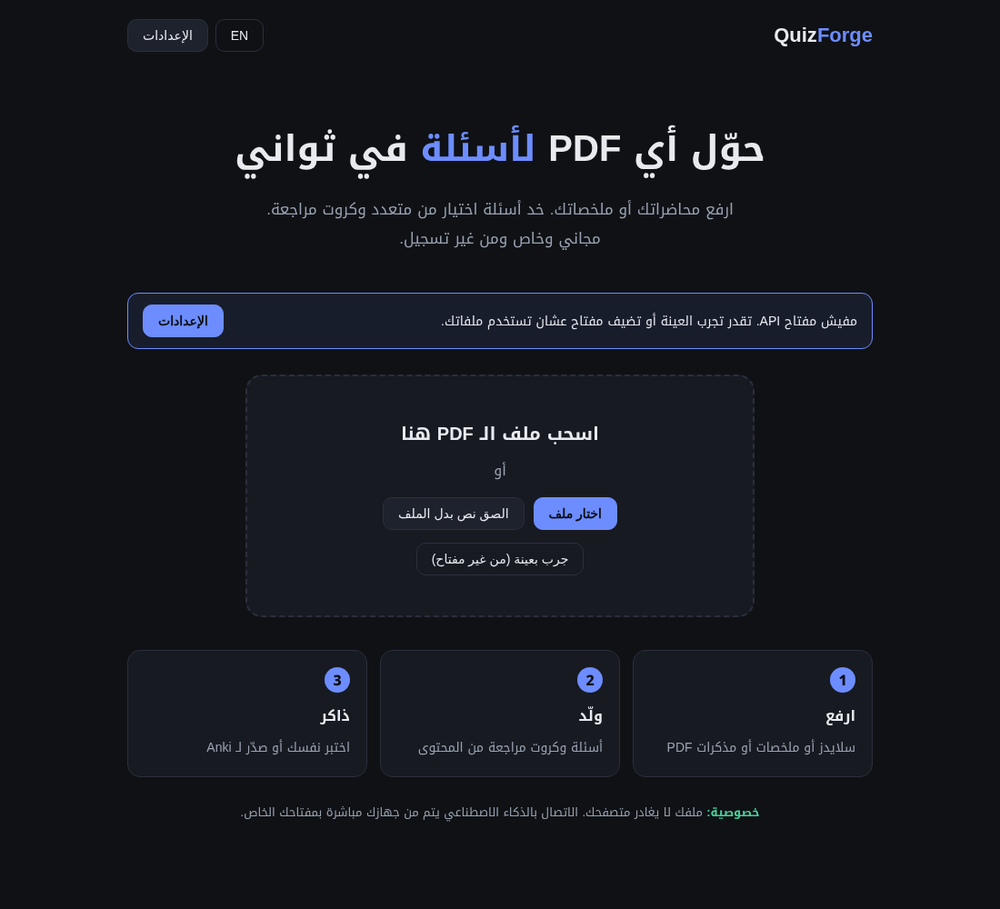
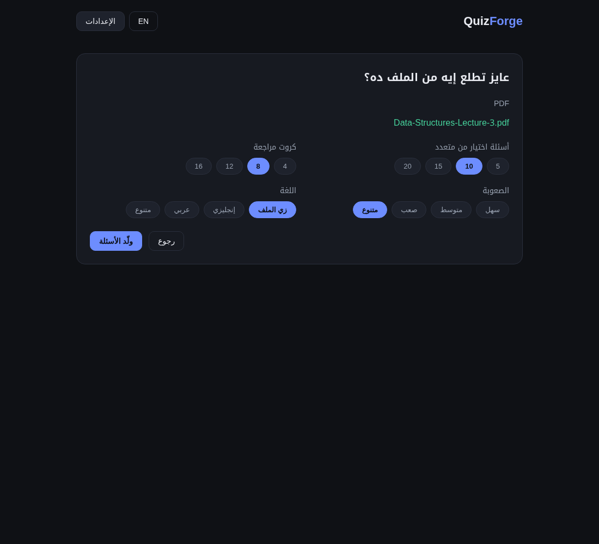
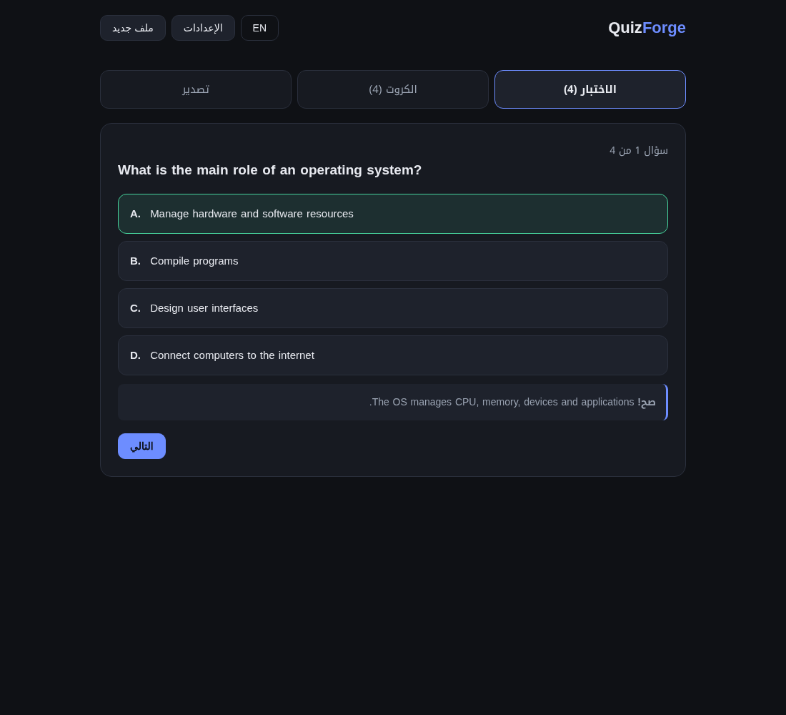
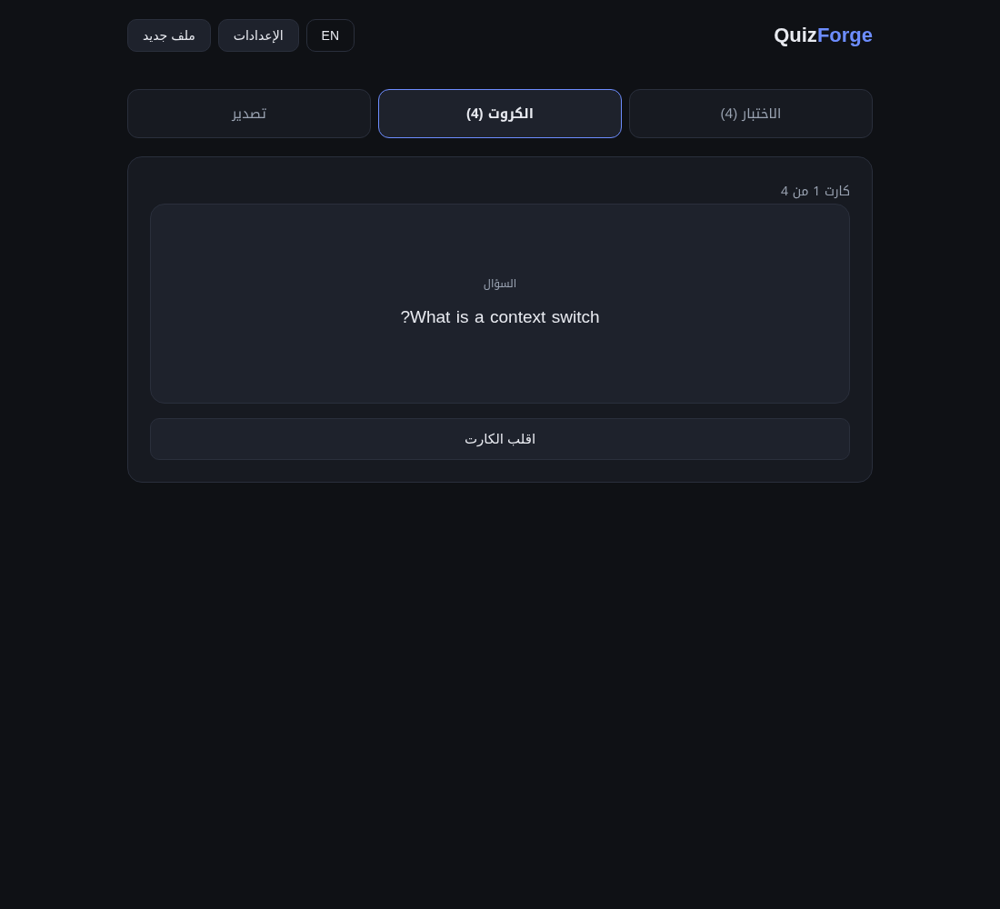
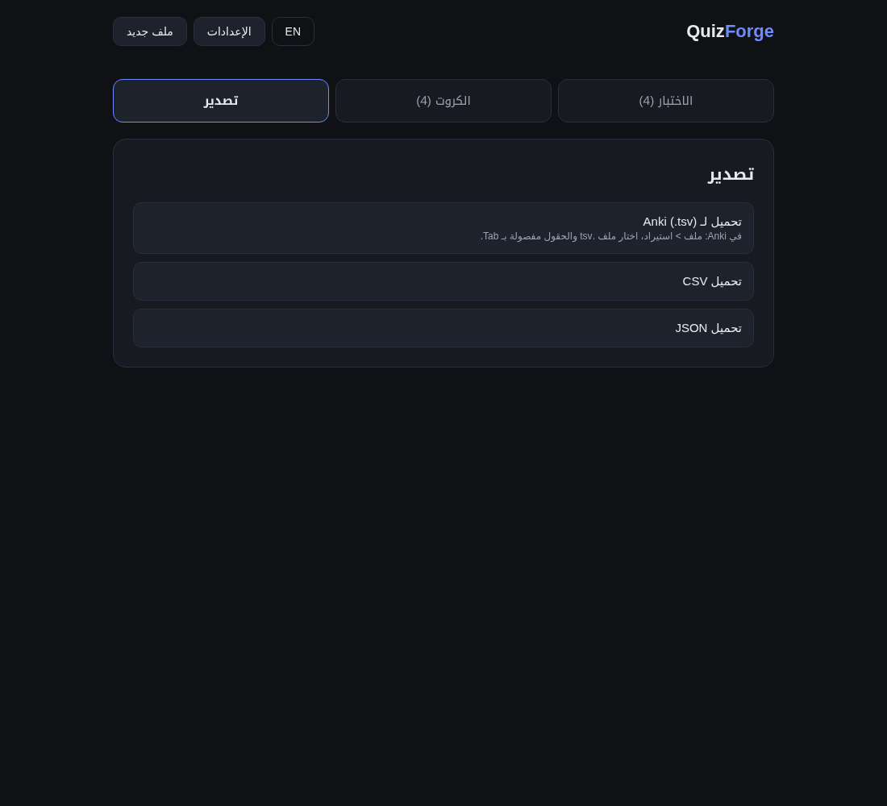
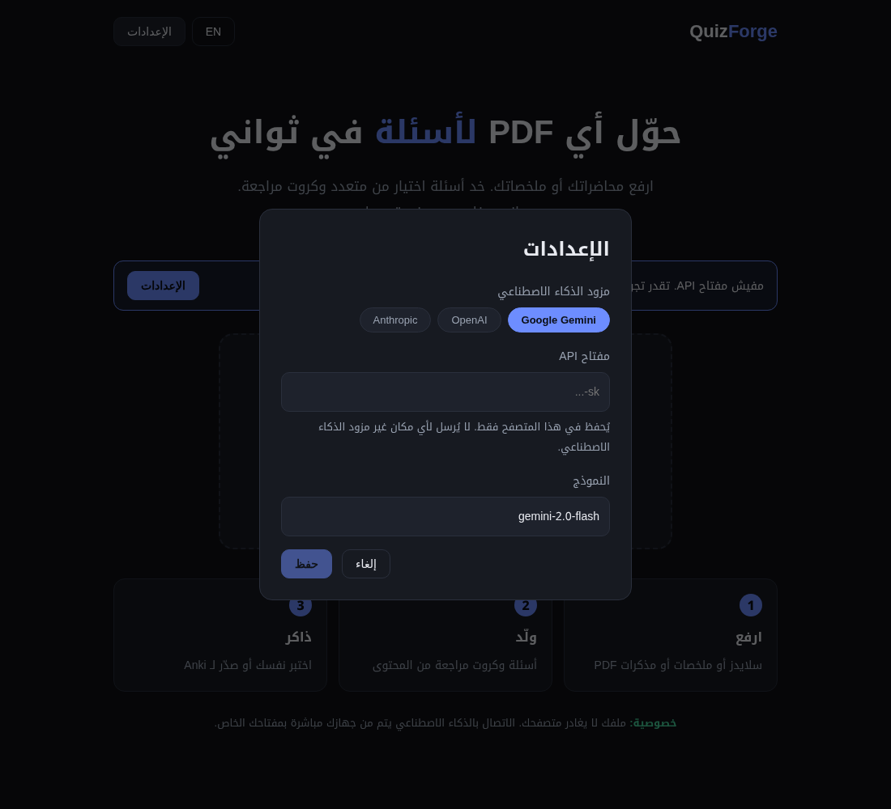

# QuizForge

Turn any PDF into MCQ quizzes and flashcards in seconds. Free, private, no signup. English and Arabic.

حوّل أي ملف PDF لأسئلة اختيار من متعدد وكروت مراجعة في ثواني. مجاني وخاص ومن غير تسجيل. بالإنجليزي والعربي.

## Live demo | جربه لايف

**[mostaaafaomran-ctrl.github.io/quizforge](https://mostaaafaomran-ctrl.github.io/quizforge/)**

Try it instantly with the built-in sample - no API key needed.

جربه فوراً بالعينة الجاهزة، من غير مفتاح API.

## Screenshots | صور

| Home | Configure | Quiz |
| --- | --- | --- |
|  |  |  |

| Flashcards | Export | Settings |
| --- | --- | --- |
|  |  |  |

## Features | المميزات

- Upload lecture slides, summaries or notes as PDF (or paste text) - text is extracted in your browser with pdf.js.
- ارفع محاضرات أو ملخصات أو مذكرات PDF (أو الصق نص)، والنص يتستخرج في متصفحك مباشرة.
- Generates MCQ questions with explanations and flashcards from the content.
- بيولّد أسئلة اختيار من متعدد مع شرح، وكروت مراجعة من المحتوى نفسه.
- Quiz mode with instant feedback and score, flashcard mode with flip and self-check.
- وضع اختبار بتصحيح فوري ونتيجة، ووضع كروت بقلب الكارت وتقييم ذاتي.
- Export to Anki (.tsv), CSV or JSON.
- تصدير لـ Anki (.tsv) أو CSV أو JSON.
- Full Arabic RTL interface with one-tap English toggle; questions can be Arabic, English, or mixed.
- واجهة عربية كاملة مع زرار للإنجليزي، والأسئلة ممكن تكون عربي أو إنجليزي أو الاتنين.
- Bring your own AI key (Google Gemini, OpenAI or Anthropic). The key is stored only in your browser's localStorage and calls go straight from your device to the provider.
- استخدم مفتاح الذكاء الاصطناعي بتاعك (Google Gemini أو OpenAI أو Anthropic). المفتاح بيتحفظ في متصفحك بس، والاتصال بيتم من جهازك للمزود مباشرة.
- No accounts, no servers, no tracking. Your file never leaves your device.
- من غير حسابات ولا سيرفرات ولا تتبع. ملفك لا يغادر جهازك.

## How it works | إزاي بيشتغل

1. **Upload** - drop your PDF. **ارفع** ملف الـ PDF.
2. **Configure** - how many MCQs and flashcards, difficulty, language. **ظبط** عدد الأسئلة والكروت والصعوبة واللغة.
3. **Generate** - the document is chunked and sent to your AI provider with your key. **ولّد**، والملف بيتقسم ويتبعت للمزود بمفتاحك.
4. **Study** - take the quiz, flip the cards, or export to Anki. **ذاكر**: اختبر نفسك، اقلب الكروت، أو صدّر لـ Anki.

## Tech stack | التقنيات

React 18, TypeScript, Vite, pdf.js. Static site, deployed on GitHub Pages.

React 18 وTypeScript وVite وpdf.js. موقع ثابت منشور على GitHub Pages.

## Run locally | تشغيل محلي

```bash
npm install
npm run dev
```

## Deploy | النشر

Every push to `main` builds and deploys to GitHub Pages via GitHub Actions.

أي push على فرع `main` بيبني الموقع وبينشره على GitHub Pages عن طريق GitHub Actions.

## License | الرخصة

MIT
